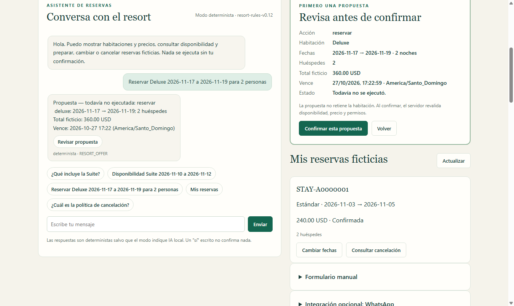
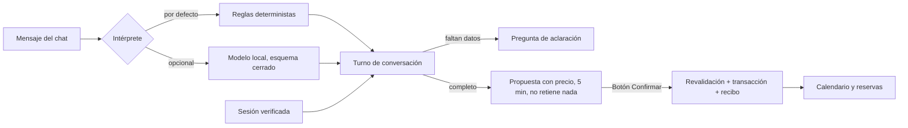

# ContactCenterAI

### Reserva un resort ficticio desde un chat, con garantías en el servidor

[English](README.md) · [Guía de la demo](docs/demo-guide.es.md) · [Escenarios](docs/demo-guide.es.md#seis-escenarios) · [Arquitectura y decisiones](docs/demo-guide.es.md#arquitectura)

Pregunta por habitaciones y fechas, recibe una propuesta con precio, confírmala y después cámbiala o cancélala. El chat es solo la puerta de entrada. Un backend en **C# / .NET** decide la identidad, la propiedad, la disponibilidad, el precio y la ejecución, y cada acción confirmada deja un recibo durable.

Es un **proyecto de portafolio**. El hotel, los precios, los huéspedes y las reservas son ficticios, no hay pagos, y el inicio de sesión es un Keycloak local real con usuarios sintéticos.



## Pruébalo en cinco minutos

Requisitos: [Docker Desktop](https://www.docker.com/products/docker-desktop/) (o Docker Engine con Compose v2) y acceso a internet para la primera construcción. **No** necesitas el SDK de .NET, Python, PowerShell, WhatsApp, un túnel, descargar un modelo ni una cuenta de pago.

```text
Windows:       start-demo.cmd
macOS / Linux: ./demo.sh start
```

Abre **http://127.0.0.1:7452** e inicia sesión como `customer-a` o `customer-b` con la clave `123456Aa!`. Las reservas se conservan al reiniciar. `stop-demo.cmd` / `./demo.sh stop` detiene la demo, y `reset-demo.cmd` / `./demo.sh reset` borra solo los datos de esta demo después de que escribas `DELETE`.

La primera vez se construye la imagen desde el código dentro de Docker y tarda unos minutos. Los puertos 7452 (aplicación) y 18080 (inicio de sesión) se publican solo en `127.0.0.1`; define `CCAI_DEMO_IDP_PORT` si el 18080 está ocupado.

## Qué probar

| # | Escenario | Qué ves |
|---|---|---|
| 1 | Reserva completa | Petición en el chat → propuesta con habitación, fechas, huéspedes, total y vencimiento → Confirmar → se actualizan el calendario y *Mis reservas* |
| 2 | Cambio rechazado | Mover una reserva a noches ocupadas devuelve `DATES_OCCUPIED` y la reserva original no cambia |
| 3 | Confirmación repetida | Confirmar dos veces devuelve el mismo recibo, sin reserva duplicada |
| 4 | Reserva de otro cliente | `customer-a` no puede cancelar la estadía de `customer-b`, aunque conozca su código |
| 5 | Respuesta perdida | Un interruptor de laboratorio, solo en el navegador, descarta una respuesta de confirmación; *Consultar recibo* recupera el resultado de esa misma propuesta |
| 6 | Ambigua o fuera de alcance | "2 o 3 personas" se pregunta en vez de suponerse; las preguntas ajenas se declinan sin inventar información |

La página tiene una sección *Escenarios* con botones que rellenan el chat para cada uno, con fechas relativas a hoy.

## Qué es real

| Parte | Estado |
|---|---|
| Reservas, propiedad, propuestas, confirmación, transacciones, recibos idempotentes, recuperación | **Implementado** en C# con SQLite y cubierto por comprobaciones deterministas |
| Inicio de sesión | **Real**: Keycloak OIDC local (Authorization Code + PKCE) con usuarios sintéticos |
| Interpretación del chat (por defecto) | **Determinista**: reglas y expresiones regulares, sin modelo |
| Interpretación del chat (opcional) | Adaptador de **IA local** para el modelo Qwen ya fijado, con esquema cerrado y sin reemplazo silencioso. El modelo no se incluye; la inferencia real queda **pendiente** de un equipo que tenga el modelo fijado |
| Asistente original con RAG (v0.10) | Implementado; se ejecuta desde el código, no en la demo Docker |
| WhatsApp | Integración opcional con su propia configuración de Meta; fuera de la demo básica |
| Telegram, Genesys, agentes humanos | Adaptador presente o **simulado**; sin tenant real |
| Hotel, precios, pagos | **Ficticios**; sin pagos |

## Cómo funciona



El texto solo **propone**. La identidad sale de la cookie de sesión, nunca del mensaje. Una propuesta solo se ejecuta con una confirmación explícita ligada a su ID, y la ejecución revalida disponibilidad, precio y permisos dentro de una transacción. La [guía de la demo](docs/demo-guide.es.md#arquitectura) muestra la topología desplegada, los estados de una operación y las decisiones de diseño.

## Evidencia y límites

- Comprobaciones deterministas en C#: las 402 originales más 41 del chat web, y 28 de la interfaz sin navegador con el runner integrado de Node. Los resultados, con fechas y comandos, están en [la nota de progreso más reciente](docs/progress/portfolio-v0.13-2026-10-27.md). Las cifras anteriores son históricas.
- CI: el workflow ejecuta estas comprobaciones y construye la imagen de la demo. Las ejecuciones remotas no arrancan desde que la cuenta de GitHub quedó bloqueada por facturación, así que todavía no hay evidencia remota.
- No se afirma: preparación para producción, certificación de seguridad, Genesys real, calidad medida del modelo en el nuevo chat ni pruebas de carga o rendimiento.

## Más

| Si quieres… | Lee |
|---|---|
| Instalar, usar y resolver problemas | [Guía de la demo](docs/demo-guide.es.md) |
| Revisar contratos | [Resort v0.13](docs/contracts/resort-v0.13.md), [base v0.12](docs/contracts/resort-v0.12.md) |
| Presentarlo en una entrevista | [Guion de entrevista](docs/interview-script.md) |
| Ver qué cambió | [Changelog](CHANGELOG.md) |
| Consultar el historial de diseño y la evidencia anterior | [Índice de documentación](docs/README.md) |

Desarrollado con ayuda de herramientas de IA; las decisiones, la evidencia y los límites están documentados para su revisión. Licencia: **aún no elegida**. Mientras el dueño no añada una, rige el copyright por defecto. [Avisos de terceros](THIRD_PARTY_NOTICES.md).
