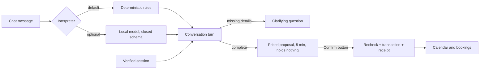

# ContactCenterAI

### Book a fictional resort from a chat, with server-side guarantees

[Español](README.es.md) · [Demo guide](docs/demo-guide.en.md) · [Scenarios](docs/demo-guide.en.md#six-scenarios) · [Architecture and decisions](docs/demo-guide.en.md#architecture)

Ask about rooms and dates, get a priced proposal, confirm it, then change or cancel it. The chat is only the front door. A **C# / .NET** backend decides identity, ownership, availability, price and execution, and every confirmed action leaves a durable receipt.

This is a **portfolio project**. The hotel, prices, guests and bookings are fictional, there are no payments, and the sign-in is a real local Keycloak with synthetic users.


## Try it in five minutes

The main path is the Docker demo in **deterministic mode**: no model, no external account. It has been checked on **Windows 11 with Docker Desktop**. `demo.sh` for macOS/Linux is included but has not been validated on those systems.

Requirements: [Docker Desktop](https://www.docker.com/products/docker-desktop/) (or Docker Engine with Compose v2) and Internet access for the first build. You do **not** need the .NET SDK, Python, PowerShell, WhatsApp, a tunnel, a model download or a paid account.

```text
Windows (checked):           start-demo.cmd
macOS / Linux (not checked): ./demo.sh start
```

Open **http://127.0.0.1:7452** and sign in as `customer-a` or `customer-b` with password `123456Aa!`. Bookings persist across restarts. `stop-demo.cmd` / `./demo.sh stop` stops the demo, and `reset-demo.cmd` / `./demo.sh reset` deletes only this demo's data after you type `DELETE`.

The first run builds the image from source inside Docker, which takes a few minutes. Ports 7452 (app) and 18080 (sign-in) are published only on `127.0.0.1`; set `CCAI_DEMO_IDP_PORT` if 18080 is taken.

## What to try

| # | Scenario | What you see |
|---|---|---|
| 1 | Complete booking | Chat request → proposal with room, dates, guests, total and expiry → Confirm → calendar and *My bookings* update |
| 2 | Rejected change | Moving a booking onto occupied nights returns `DATES_OCCUPIED`; the original booking is unchanged |
| 3 | Repeated confirmation | Confirming twice returns the same receipt and no duplicate booking |
| 4 | Another customer's booking | `customer-a` cannot cancel `customer-b`'s stay, even with its code |
| 5 | Lost response | A browser-only lab switch drops one confirm response; *Check receipt* recovers the outcome of the same proposal |
| 6 | Ambiguous or out of scope | "2 or 3 guests" is asked about, not assumed; unrelated questions are declined without inventing content |

The page has a *Scenarios* section with buttons that fill the chat for each one, using dates relative to today.

## What is real

| Part | Status |
|---|---|
| Bookings, ownership, offers, confirmation, transactions, idempotent receipts, recovery | **Implemented** in C# with SQLite and covered by deterministic checks |
| Sign-in | **Real** local Keycloak OIDC (Authorization Code + PKCE) with synthetic users |
| Chat interpretation (default) | **Deterministic** rules and regular expressions, no model |
| Chat interpretation (optional) | **Local AI, run locally by the author on 2026-10-27, not reproducible on a new installation today:** the project pins one exact build of `qwen3-vl`, and the registry no longer serves it, so a fresh setup cannot obtain that model. On the author's PC, a 22-case development sample gave 21/22 before one prompt adjustment and 22/22 after it (the deterministic rules gave 19/22). The adjustment added an example derived from one of those cases, so the sample shows no generalization, production quality or overall accuracy. See the [details](docs/progress/local-ai-chat-2026-10-27.md) and the [guide](docs/demo-guide.en.md#modes-deterministic-and-local-ai) |
| Original assistant with RAG (v0.10) | Implemented; runs from source, not in the Docker demo |
| WhatsApp | Optional integration with its own Meta setup; outside the basic demo |
| Telegram, Genesys, human agents | Adapter present or **simulated**; no live tenant |
| Hotel, prices, payments | **Fictional**; no payments |

## How it works



The text only **proposes**. Identity comes from the session cookie, never from the message. A proposal is executed only by an explicit confirmation bound to its ID, and execution rechecks availability, price and permissions inside one transaction. See the [demo guide](docs/demo-guide.en.md#architecture) for the deployed topology, the operation states and the design decisions.

## Evidence and limits

- Deterministic C# checks: the original 402 plus 44 web-chat checks, and 28 browser-free UI checks with Node's built-in runner. Results with dates and commands are in [the latest progress note](docs/progress/portfolio-v0.13-2026-10-27.md). Earlier figures are historical.
- CI: the workflow runs these checks and builds the demo image. Remote runs have not started since the GitHub account's billing lock, so there is no remote evidence yet.
- Platforms: checked only on Windows 11 with Docker Desktop.
- Not claimed: production readiness, security certification, live Genesys, general or production accuracy of the local model (only a 22-case development sample exists), or load/performance benchmarks.

## More

| If you want to… | Read |
|---|---|
| Install, use and troubleshoot | [Demo guide](docs/demo-guide.en.md) |
| Review contracts | [Resort v0.13](docs/contracts/resort-v0.13.md), [v0.12 baseline](docs/contracts/resort-v0.12.md) |
| Present it | [60–90 s demo script, 2-minute explanation, recording guide](docs/presentation.md) and [interview script](docs/interview-script.md) (Spanish) |
| See what changed | [Changelog](CHANGELOG.md) |
| Browse design history and earlier evidence | [Documentation index](docs/README.md) |

Built with AI-assisted tooling; decisions, evidence and limitations are documented for review. Licence: **not chosen yet**. Until the owner adds one, default copyright applies. [Third-party notices](THIRD_PARTY_NOTICES.md).
