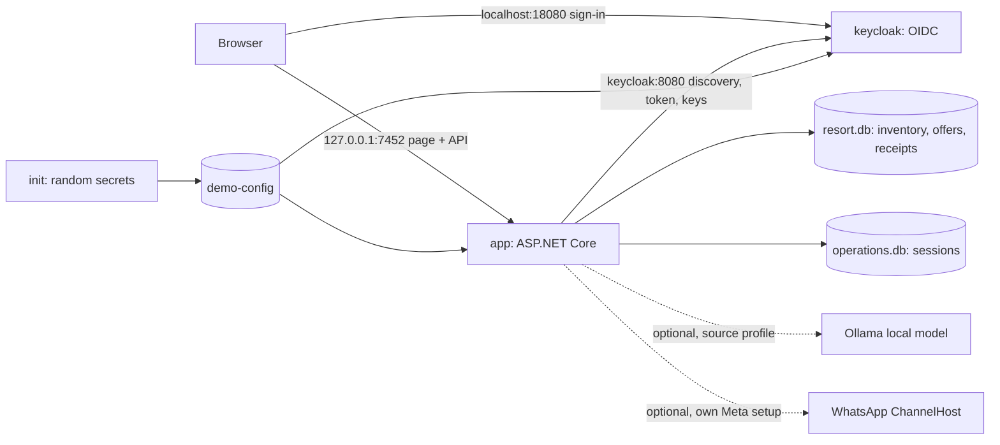
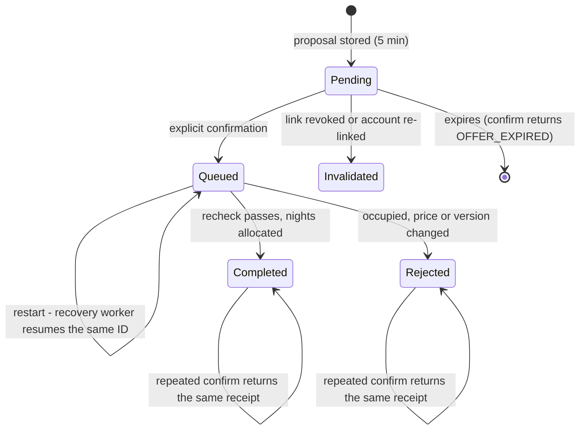

# Demo guide

[Español](demo-guide.es.md) · [README](../README.md)

This is the current guide for installing and using the resort demo (v0.13). Older setup and walkthrough pages are kept as history and say so at the top.

## Install and start

You need Docker Desktop, or Docker Engine with Compose v2, and Internet access the first time. From the repository root:

| Action | Windows | macOS / Linux |
|---|---|---|
| Start (build on first run) | `start-demo.cmd` | `./demo.sh start` |
| Stop, keeping data | `stop-demo.cmd` | `./demo.sh stop` |
| Status / logs | `docker compose -f deploy/demo/compose.yaml ps` / `logs` | `./demo.sh status` / `./demo.sh logs` |
| Delete this demo's data | `reset-demo.cmd` (type `DELETE`) | `./demo.sh reset` |

The start script runs `docker compose -f deploy/demo/compose.yaml up -d --build --wait`. Three services start:

- `init` runs once and writes random service secrets (OIDC client secret, Keycloak admin password, internal service key) to the `demo-config` volume. If the file already exists, it keeps it.
- `keycloak` imports the synthetic realm from `deploy/local/keycloak` on first start (users, roles, exact callback) and keeps it in `keycloak-data`.
- `app` is the ASP.NET Core API and web page. It is built from source inside Docker with the exact SDK from `global.json`, locked NuGet restore and NuGet audit enabled. SQLite data lives in `app-data`.

Open **http://127.0.0.1:7452**. Use exactly `127.0.0.1` for the app and let it redirect you to `localhost:18080` for sign-in: those are the addresses the OIDC configuration expects. Accounts: `customer-a`, `customer-b` (customers) and `operations-admin` (inventory admin), password `123456Aa!`. These are public synthetic fixtures; the generated service secrets are not.

### Troubleshooting

| Symptom | What to do |
|---|---|
| "Docker is installed but not running" | Start Docker Desktop and run the start script again |
| Port 7452 already in use | Stop the other program; the app port is fixed because the realm's callback is `http://127.0.0.1:7452/signin-oidc` |
| Port 18080 already in use | Set another port before starting, e.g. `set CCAI_DEMO_IDP_PORT=18081` (Windows) or `CCAI_DEMO_IDP_PORT=18081 ./demo.sh start` |
| Sign-in page does not open | Check `docker compose -f deploy/demo/compose.yaml ps`: `keycloak` must be `healthy` |
| "Session expired" | Sessions last 15 minutes. Sign in again; bookings are kept |
| Old dates in the scenarios | Seed bookings are relative to the day the demo was created. `reset-demo` recreates them for today |

## Use

- **Chat.** Ask in Spanish or English. Without signing in you can see rooms, prices, availability and the policy. Bookings need a customer session. When a detail is missing (room, dates, an exact guest count, which booking) the chat asks and offers an example you can edit.
- **Proposal.** Shows the room, dates and nights, guests, fictional total, expiry (five minutes, Santo Domingo time) and "not executed yet". It holds nothing. *Back* discards it.
- **Confirm.** Only this button executes. The server rechecks availability, price, ownership and session in one transaction and returns a receipt. Pressing it again returns the same receipt.
- **Unverified result.** If the confirm response is lost, the page shows "unverified" and *Check receipt* asks the server for the receipt of that same proposal. If there is none yet, it was not executed and can be confirmed again safely.
- **My bookings** and the **calendar** show the server's current state. The **manual form** gives the same operations without the chat.
- **Technical panel** (collapsed, at the bottom): active mode, last code, the interpretation (which never authorizes anything), missing details, assumptions, proposal, receipt, server-side validations and the last calls (method, path and status only).

## Six scenarios

The *Scenarios* section of the page has buttons that fill the chat with text for each scenario, using dates relative to today. Nothing is sent until you press *Send*.

1. **Complete booking.** Sign in as `customer-a` and send `Reservar Deluxe <date> a <date> para 2 personas`. Review the proposal and press *Confirm*. The nights turn *Occupied* and the booking appears under *My bookings*.
2. **Rejected change.** Signed in as a customer, ask to move your booking onto nights the calendar shows as occupied or under maintenance (for example `Cambiar STAY-… suite <date> a <date>`). The answer is `DATES_OCCUPIED` and the original booking keeps its dates and nights. The same rule applies if the nights become occupied between the proposal and the confirmation: the confirmation is rejected and nothing changes.
3. **Repeated confirmation.** After scenario 1, press *Repeat confirmation*. You get the same receipt ("same receipt as before") and *My bookings* shows a single booking.
4. **Another customer's booking.** As `customer-a`, send `Cancelar STAY-B0000001`, the seeded booking of `customer-b`. The answer is `RESOURCE_NOT_FOUND` and reveals nothing. Knowing a code grants no access.
5. **Recovered result, with an injected fault.** Turn on the *Lab* switch under the scenarios, prepare a proposal and confirm it. The server processes the confirmation, but the page discards the response and shows "unverified". *Check receipt* returns the stored receipt of the same proposal, and the operation is not repeated. The fault exists only in this browser page and never changes the server.
6. **Ambiguous or out of scope.** `Reservar Suite <date> a <date> para 2 o 3 personas` asks for an exact count instead of assuming one. `¿Qué tiempo hace en París?` is declined without invented content.

## Modes: deterministic and local AI

| Mode | How the chat is interpreted | Requirements | Status |
|---|---|---|---|
| Deterministic (default, Docker demo) | `resort-rules-v0.12`: keywords and regular expressions, plus guest, policy and reference checks | None | Implemented and tested |
| Local AI (optional) | `OllamaResortInterpreter`: the existing pinned model `qwen3-vl` (digest `901cae73…`, 8.8B, Q4_K_M, 6.14 GB) proposes six fields under a closed JSON schema | Ollama on the same computer, listening on `127.0.0.1:11434`, with that exact digest already installed; about 6 GB of free RAM (it runs on CPU) | Run on 2026-10-27 from the Docker demo: development sample 22/22 after one prompt round (21/22 before; rules 19/22), 3.5–6.8 s per message. See [the note](progress/local-ai-chat-2026-10-27.md) |

In both modes the interpreter only proposes. Clarification, ownership, offer, confirmation and receipts are the same C# code. In local AI mode, an unavailable model, a digest mismatch, a timeout or a response outside the schema returns an explicit code. The demo never falls back silently to the rules and never downloads a model.

**Turning on local AI in the Docker demo.** Start with `start-demo.cmd ai` (Windows) or `./demo.sh start-ai`; `start-demo.cmd` without `ai` returns to deterministic mode. The app reaches the host's Ollama through `host.docker.internal:11434`, which Docker Desktop forwards to the host loopback, so Ollama never listens on the network. At startup the app checks the digest and loads the model once, because loading it cold on CPU takes longer than the eight-second answer deadline. The header then shows *Local AI* and the provider `ollama:qwen3-vl@901cae732162:resort-intent-local-v1`.

**Important: the pinned model may not be downloadable any more.** The registry's `qwen3-vl:latest` now points to a different build. A fresh `ollama pull qwen3-vl:latest` gives a digest the app rejects with `LOCAL_MODEL_PIN_MISMATCH`. That is the intended safeguard, but it means local AI only works where the pinned digest is already installed. Re-pinning to a new build would be a model change and needs its own evaluation. Running `ollama pull` on a computer that has the pinned model would move the tag away from it.

**What happens on failure.** If the model is missing, has another digest, is unreachable or times out, the chat answers with that code (`LOCAL_MODEL_PIN_MISMATCH`, `LOCAL_MODEL_UNAVAILABLE`, `LOCAL_MODEL_TIMEOUT`) and prepares nothing. It never answers with the rules instead. Only tested with Docker Desktop on Windows; on a Linux Docker engine, `host.docker.internal` maps to the bridge gateway, which an Ollama bound to loopback does not accept.

From source, without Docker, set `$env:CCAI_RESORT_INTERPRETER='local-llm'` and run `./eng/Start-Resort.ps1` in PowerShell 7 after the [source setup](en/getting-started.md). The WhatsApp bridge always uses the deterministic rules. The original v0.10 assistant with governed RAG runs with `./eng/Start-Demo.ps1 -IntentProvider local-llm`; its earlier measurements are historical and do not describe the new chat.

## Architecture

### Deployed demo



Both ports are published only on the host loopback. Inside Docker the app reaches Keycloak as `keycloak:8080` and still validates tokens against the browser issuer `http://localhost:18080/realms/contactcenterai-local`. That port is configurable because 8080 is often taken, and the issuer must remain an `http://localhost` URL of the demo realm. In container mode the in-process network check accepts the Docker bridge, because the loopback-only published port is now the outer boundary. Host, Origin and antiforgery checks are unchanged.

### Booking journey

```mermaid
sequenceDiagram
    participant U as Visitor
    participant P as Page
    participant S as Server (C#)
    participant D as SQLite
    U->>P: "Book Suite 12-03 to 12-05 for 2"
    P->>S: POST /v2/resort/chat (session cookie, CSRF, Idempotency-Key)
    S->>S: interpret (rules or model) - proposes only
    S->>S: actor from session; ask if details missing
    S->>D: validate dates, capacity, price; store 5-min offer
    S-->>P: proposal (no booking yet)
    U->>P: press Confirm
    P->>S: POST /v2/resort/offers/{id}/confirm
    S->>D: one transaction: recheck, allocate each night once, receipt
    S-->>P: receipt (same receipt if repeated)
    Note over P,S: Response lost? GET /v2/resort/operations/{id} returns the stored receipt
```

### Operation states



### Decisions and their limits

- **The model or parser proposes; C# decides.** The interpretation is a closed request and never selects the account. Limit: language coverage of the deterministic rules is narrow (declared examples, not open understanding).
- **Proposal then confirmation.** The proposal holds nothing and expires in five minutes. Confirmation rechecks everything in one SQLite transaction with a unique `(room, night)` allocation. Limit: single-node SQLite, sized for a demo.
- **Idempotency and receipts.** The same message key returns the same proposal, and the same proposal ID returns the same receipt. A lost response is recovered by reading the receipt, never by running the action again.
- **Identity from the session only.** OIDC with Keycloak gives the session, and roles and member come from the server's binding. Text such as "I am customer-b" is ignored.
- **Ask instead of assume.** A missing room, dates or an exact guest count produces a question. A change keeps the booking's own guest count.
- **Container profile.** Configuration is explicit and opt-in, and the protections stay in place. Limit: local demo only. A public deployment would need HTTPS, external secrets, per-visitor isolation and a different identity setup.
- **Not done.** Payments, real hotel systems, live Genesys, load testing, security certification and measured model quality for this chat.

## For developers

| Command | What it checks |
|---|---|
| `./eng/Verify-Demo.ps1 -DotNetExe <sdk>` | Locked restore with audit, Release build, every C# check suite, Python evaluators |
| `node --test "tests/web/*.test.mjs"` | Resort page behavior over the real HTML in a simulated DOM; no browser |
| `docker compose -f deploy/demo/compose.yaml build` | Demo image builds from source |

`Verify-Demo.ps1` and several older suites rewrite tracked evidence files. Review `git status` afterwards and do not commit those rewrites by accident. The [resort v0.13 contract](contracts/resort-v0.13.md) lists the acceptance criteria.
