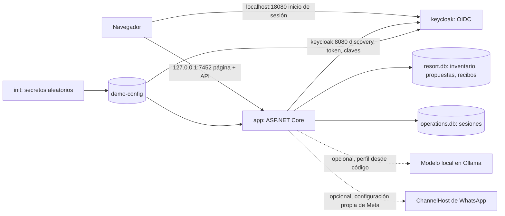
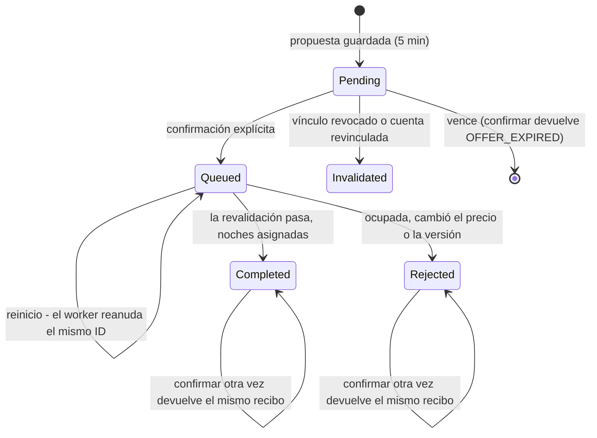

# Guía de la demo

[English](demo-guide.en.md) · [README](../README.es.md)

Esta es la guía vigente para instalar y usar la demo del resort (v0.13). Las páginas anteriores de preparación y recorrido se conservan como historia y lo indican al principio.

## Instalar e iniciar

Necesitas Docker Desktop, o Docker Engine con Compose v2, y acceso a internet la primera vez. Desde la raíz del repositorio: Comprobado en Windows 11 con Docker Desktop; macOS y Linux no están validados.

| Acción | Windows | macOS / Linux |
|---|---|---|
| Iniciar (construye la primera vez) | `start-demo.cmd` | `./demo.sh start` |
| Detener conservando los datos | `stop-demo.cmd` | `./demo.sh stop` |
| Estado / registros | `docker compose -f deploy/demo/compose.yaml ps` / `logs` | `./demo.sh status` / `./demo.sh logs` |
| Borrar los datos de esta demo | `reset-demo.cmd` (escribe `DELETE`) | `./demo.sh reset` |

El script de inicio ejecuta `docker compose -f deploy/demo/compose.yaml up -d --build --wait`. Arrancan tres servicios:

- `init` se ejecuta una vez y escribe secretos de servicio aleatorios (secreto del cliente OIDC, clave de administración de Keycloak, clave interna) en el volumen `demo-config`. Si el archivo ya existe, lo conserva.
- `keycloak` importa el realm sintético de `deploy/local/keycloak` en el primer arranque (usuarios, roles, callback exacto) y lo conserva en `keycloak-data`.
- `app` es la API ASP.NET Core con la página web. Se construye desde el código dentro de Docker, con el SDK exacto de `global.json`, restore de NuGet con lock y auditoría activa. Los datos SQLite viven en `app-data`.

Abre **http://127.0.0.1:7452**. Usa exactamente `127.0.0.1` para la aplicación y deja que te redirija a `localhost:18080` para iniciar sesión: son las direcciones que espera la configuración OIDC. Cuentas: `customer-a` y `customer-b` (clientes) y `operations-admin` (administración del inventario), clave `123456Aa!`. Son fixtures sintéticos públicos; los secretos de servicio generados no lo son.

### Problemas frecuentes

| Síntoma | Qué hacer |
|---|---|
| "Docker is installed but not running" | Abre Docker Desktop y vuelve a ejecutar el script de inicio |
| Puerto 7452 ocupado | Detén el otro programa; el puerto de la aplicación es fijo porque el callback del realm es `http://127.0.0.1:7452/signin-oidc` |
| Puerto 18080 ocupado | Elige otro antes de iniciar, por ejemplo `set CCAI_DEMO_IDP_PORT=18081` (Windows) o `CCAI_DEMO_IDP_PORT=18081 ./demo.sh start` |
| No abre la página de inicio de sesión | Revisa `docker compose -f deploy/demo/compose.yaml ps`: `keycloak` debe estar `healthy` |
| "Sesión vencida" | Las sesiones duran 15 minutos. Vuelve a entrar; las reservas se conservan |
| Fechas antiguas en los escenarios | Las reservas sembradas son relativas al día en que se creó la demo. `reset-demo` las recrea para hoy |

## Uso

- **Chat.** Pregunta en español o en inglés. Sin sesión puedes ver habitaciones, precios, disponibilidad y la política. Las reservas requieren sesión de cliente. Si falta un dato (habitación, fechas, número exacto de huéspedes, qué reserva), el chat lo pregunta y ofrece un ejemplo editable.
- **Propuesta.** Muestra la habitación, las fechas y noches, los huéspedes, el total ficticio, el vencimiento (cinco minutos, hora de Santo Domingo) y "todavía no se ejecutó". No retiene nada. *Volver* la descarta.
- **Confirmar.** Solo este botón ejecuta. El servidor revalida disponibilidad, precio, propiedad y sesión en una transacción y devuelve un recibo. Pulsarlo otra vez devuelve el mismo recibo.
- **Resultado sin verificar.** Si se pierde la respuesta de la confirmación, la página muestra "sin verificar" y *Consultar recibo* pide al servidor el recibo de esa misma propuesta. Si todavía no existe, no se ejecutó y puede confirmarse de nuevo sin riesgo.
- **Mis reservas** y el **calendario** muestran el estado actual del servidor. El **formulario manual** ofrece las mismas operaciones sin el chat.
- **Panel técnico** (colapsado, al final): modo activo, último código, la interpretación (que nunca autoriza nada), datos que faltan, supuestos, propuesta, recibo, validaciones del servidor y las últimas llamadas (solo método, ruta y estado).

## Seis escenarios

La sección *Escenarios* de la página tiene botones que rellenan el chat con el texto de cada escenario, con fechas relativas a hoy. No se envía nada hasta que pulsas *Enviar*.

1. **Reserva completa.** Inicia sesión como `customer-a` y envía `Reservar Deluxe <fecha> a <fecha> para 2 personas`. Revisa la propuesta y pulsa *Confirmar*. Las noches pasan a *Ocupada* y la reserva aparece en *Mis reservas*.
2. **Cambio rechazado.** Con sesión de cliente, pide mover tu reserva a noches que el calendario muestra ocupadas o en mantenimiento (por ejemplo `Cambiar STAY-… suite <fecha> a <fecha>`). La respuesta es `DATES_OCCUPIED` y la reserva original conserva sus fechas y noches. Lo mismo ocurre si las noches se ocupan entre la propuesta y la confirmación: la confirmación se rechaza y nada cambia.
3. **Confirmación repetida.** Después del escenario 1, pulsa *Repetir confirmación*. Recibes el mismo recibo ("mismo recibo que antes") y *Mis reservas* muestra una sola reserva.
4. **Reserva de otro cliente.** Como `customer-a`, envía `Cancelar STAY-B0000001`, la reserva sembrada de `customer-b`. La respuesta es `RESOURCE_NOT_FOUND` y no revela nada. Conocer un código no da acceso.
5. **Resultado recuperado, con un fallo inyectado.** Activa el interruptor *Laboratorio* bajo los escenarios, prepara una propuesta y confírmala. El servidor procesa la confirmación, pero la página descarta la respuesta y muestra "sin verificar". *Consultar recibo* devuelve el recibo guardado de esa misma propuesta y la operación no se repite. El fallo existe solo en esta página del navegador y nunca modifica el servidor.
6. **Ambigua o fuera de alcance.** `Reservar Suite <fecha> a <fecha> para 2 o 3 personas` pide un número exacto en lugar de suponerlo. `¿Qué tiempo hace en París?` se declina sin inventar información.

## Modos: determinista e IA local

| Modo | Cómo se interpreta el chat | Requisitos | Estado |
|---|---|---|---|
| Determinista (por defecto, demo Docker) | `resort-rules-v0.12`: palabras clave y expresiones regulares, más comprobaciones de huéspedes, política y referencia | Ninguno | Implementado y probado |
| IA local (opcional) | `OllamaResortInterpreter`: el modelo ya fijado `qwen3-vl` (digest `901cae73…`, 8.8B, Q4_K_M, 6,14 GB) propone seis campos con un esquema JSON cerrado | Ollama en el mismo equipo, escuchando en `127.0.0.1:11434`, con ese digest exacto ya instalado; unos 6 GB de RAM libre (se ejecuta en CPU) | Ejecutado en el equipo del autor el 2026-10-27 desde la demo Docker; no se puede obtener en una instalación nueva (ver abajo). Muestra de desarrollo de 22 casos: 21/22 antes de un ajuste del prompt y 22/22 después; el ajuste añadió un ejemplo derivado de un caso, así que no demuestra generalización ni precisión global (reglas: 19/22). 3,5–6,8 s por mensaje. Ver [la nota](progress/local-ai-chat-2026-10-27.md) |

En ambos modos el intérprete solo propone. La aclaración, la propiedad, la propuesta, la confirmación y los recibos son el mismo código C#. En modo IA local, un modelo no disponible, un digest distinto, un timeout o una respuesta fuera del esquema devuelven un código explícito. La demo nunca cambia en silencio a las reglas y nunca descarga un modelo.

**Lee esto primero: hoy una instalación nueva no puede obtener el modelo fijado.** El proyecto fija una versión exacta de `qwen3-vl` (digest `901cae73…`). El 2026-10-27 la etiqueta `qwen3-vl:latest` del registro apuntaba a otra versión, y el registro no servía la fijada por su digest. La IA local se ejecutó en el equipo del autor, donde esa versión ya estaba instalada. Un `ollama pull qwen3-vl:latest` **no** lo resuelve: la aplicación rechaza la otra versión con `LOCAL_MODEL_PIN_MISMATCH`, y en un equipo que tiene la versión fijada la descarga hace que la etiqueta deje de apuntar a ella. Sustituir el modelo requiere una decisión explícita y una evaluación nueva; nunca se hace en silencio.

**Activar la IA local en la demo Docker (solo donde la versión fijada ya está instalada).** Inicia con `start-demo.cmd ai` (Windows) o `./demo.sh start-ai`; `start-demo.cmd` sin `ai` vuelve al modo determinista. La aplicación llega al Ollama del host por `host.docker.internal:11434`, que Docker Desktop reenvía al loopback del host, así que Ollama nunca escucha en la red. Al arrancar, la aplicación comprueba el digest y carga el modelo una vez, porque cargarlo en frío en CPU tarda más que el plazo de respuesta de ocho segundos. La cabecera muestra entonces *IA local* y el proveedor `ollama:qwen3-vl@901cae732162:resort-intent-local-v1`.

**Qué pasa si falla.** Si el modelo falta, tiene otro digest, no responde o supera el plazo, el chat devuelve ese código (`LOCAL_MODEL_PIN_MISMATCH`, `LOCAL_MODEL_UNAVAILABLE`, `LOCAL_MODEL_TIMEOUT`) y no prepara nada. Nunca responde con las reglas en su lugar. Solo se probó con Docker Desktop en Windows; en un motor Docker de Linux, `host.docker.internal` apunta a la puerta de enlace de la red puente, que un Ollama ligado a loopback no acepta.

Desde el código, sin Docker, define `$env:CCAI_RESORT_INTERPRETER='local-llm'` y ejecuta `./eng/Start-Resort.ps1` en PowerShell 7 tras la [preparación desde el código](es/primeros-pasos.md). El puente de WhatsApp siempre usa las reglas deterministas. El asistente original v0.10 con RAG gobernado se ejecuta con `./eng/Start-Demo.ps1 -IntentProvider local-llm`; sus mediciones anteriores son históricas y no describen el nuevo chat.

## Arquitectura

### Demo desplegada



Ambos puertos se publican solo en el loopback del host. Dentro de Docker la aplicación llega a Keycloak como `keycloak:8080` y sigue validando los tokens contra el issuer del navegador, `http://localhost:18080/realms/contactcenterai-local`. Ese puerto es configurable porque el 8080 suele estar ocupado, y el issuer debe seguir siendo una URL `http://localhost` del realm de la demo. En modo contenedor, la comprobación de red dentro del proceso acepta la red puente de Docker, porque ahora la frontera exterior es el puerto publicado solo en loopback. Las comprobaciones de Host, Origin y antiforgery no cambian.

### Recorrido de una reserva

```mermaid
sequenceDiagram
    participant U as Visitante
    participant P as Página
    participant S as Servidor (C#)
    participant D as SQLite
    U->>P: "Reservar Suite 12-03 a 12-05 para 2"
    P->>S: POST /v2/resort/chat (cookie de sesión, CSRF, Idempotency-Key)
    S->>S: interpretar (reglas o modelo) - solo propone
    S->>S: actor desde la sesión; preguntar si faltan datos
    S->>D: validar fechas, capacidad y precio; guardar propuesta de 5 min
    S-->>P: propuesta (todavía sin reserva)
    U->>P: pulsar Confirmar
    P->>S: POST /v2/resort/offers/{id}/confirm
    S->>D: una transacción: revalidar, asignar cada noche una vez, recibo
    S-->>P: recibo (el mismo si se repite)
    Note over P,S: ¿Respuesta perdida? GET /v2/resort/operations/{id} devuelve el recibo guardado
```

### Estados de una operación



### Decisiones y sus límites

- **El modelo o el parser proponen; C# decide.** La interpretación es una petición cerrada y nunca elige la cuenta. Límite: la cobertura lingüística de las reglas deterministas es estrecha (ejemplos declarados, no comprensión abierta).
- **Propuesta y después confirmación.** La propuesta no retiene nada y vence a los cinco minutos. La confirmación revalida todo en una transacción SQLite con una asignación única `(habitación, noche)`. Límite: SQLite en un solo nodo, dimensionado para una demo.
- **Idempotencia y recibos.** La misma clave de mensaje devuelve la misma propuesta, y el mismo ID de propuesta devuelve el mismo recibo. Una respuesta perdida se recupera leyendo el recibo, nunca ejecutando de nuevo.
- **Identidad solo desde la sesión.** OIDC con Keycloak da la sesión, y los roles y el miembro salen del vínculo del servidor. Un texto como "soy customer-b" se ignora.
- **Preguntar en vez de suponer.** Si falta la habitación, las fechas o un número exacto de huéspedes, el chat pregunta. Un cambio conserva los huéspedes de la propia reserva.
- **Perfil contenedor.** La configuración es explícita y opcional, y las protecciones se mantienen. Límite: solo demo local. Un despliegue público requeriría HTTPS, secretos externos, aislamiento por visitante y otra configuración de identidad.
- **No incluido.** Pagos, sistemas hoteleros reales, Genesys real, pruebas de carga, certificación de seguridad y calidad medida del modelo en este chat.

## Para desarrolladores

| Comando | Qué comprueba |
|---|---|
| `./eng/Verify-Demo.ps1 -DotNetExe <sdk>` | Restore con lock y auditoría, build Release, todas las suites C#, evaluadores Python |
| `node --test "tests/web/*.test.mjs"` | Comportamiento de la página del resort sobre el HTML real en un DOM simulado; sin navegador |
| `docker compose -f deploy/demo/compose.yaml build` | La imagen de la demo se construye desde el código |

`Verify-Demo.ps1` y varias suites antiguas reescriben archivos de evidencia versionados. Revisa `git status` después y no hagas commit de esas reescrituras por accidente. El [contrato resort v0.13](contracts/resort-v0.13.md) lista los criterios de aceptación.
